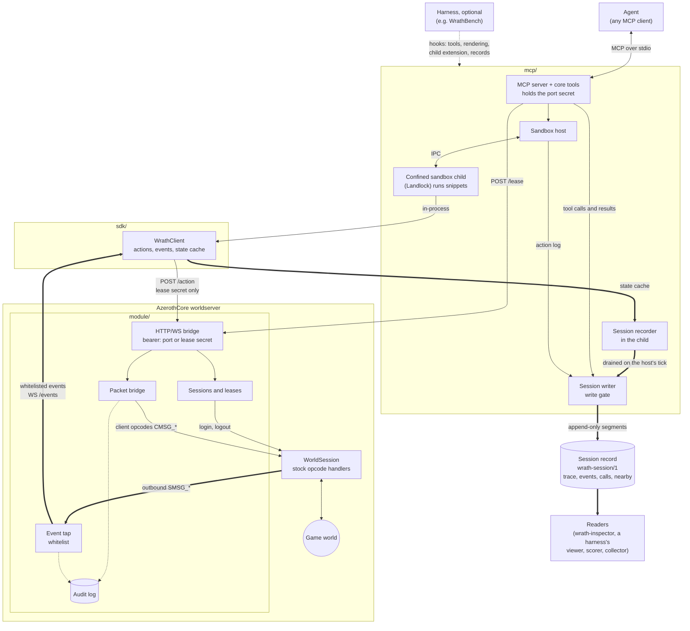

# Architecture

## Components

Thin arrows carry calls and actions, thick arrows carry observations and what
is recorded of them. The stack is a client-equivalent agent surface over a
stock AzerothCore, packets not pixels, in three pieces, and a reader of what
it records. It knows what a client
knows and does what a client does, and serves it to any MCP-capable agent.

It records what its own sessions did and knows nothing of what drove them. The
session record (the trace and character sheet, game events, tool calls and
their results) is the stack's: `mcp/` writes it to the session store and
`inspector/` reads it. Episodes,
scores, model trajectories (requests, responses, tokens, cost, turns,
compaction) and anything that compares one run with another are a harness's,
plugged in through its hooks. The stack never reads them, and no record of its
own carries a harness's ids or configuration.

- `module/` is the worldserver module. It takes actions as the client opcodes a
  client would send and serves the packets a client would receive.
- `sdk/` is the typed client over that wire.
- `mcp/` is the agent surface over the SDK.
- `inspector/` is wrath-inspector, a read-only server and views over a
  session store. It is coupled to the record's format and to nothing else.

What an agent may observe and do is `docs/CONTRACTS.md`; the wire is
`module/PROTOCOL.md`. Together they are the stack's specification, and
`docs/SESSION-FORMAT.md` is the format of what it records. The rest of this
document is how the code meets them.

## The stack and a harness

The stack runs on its own: `bun mcp/src/main.ts` serves the core tools over
stdio with a plain rendering of events and state (`README.md`, "Quick start").
A harness that wants more, such as an evaluation loop, its own tools or a
record of every turn, builds on the same pieces rather than forking them.
[WrathBench](https://github.com/Shard/WrathBench), an LLM evaluation harness,
is one such harness and the stack's first consumer.

The line between the two is enforced rather than hoped for. `bun run boundary`
(`scripts/boundary.ts`, also run by `bun test` and CI) fails when a TypeScript
file in `sdk/`, `mcp/` or `inspector/` imports anything but its own package,
Bun and Node built-ins and the dependencies its `package.json` declares, at an
exported subpath, or when a module include names a path out of `module/`.
`sdk/` declares no stack dependency, so it never imports `mcp/`; `mcp/`
reaches the SDK through `@wrathbench/sdk` alone. The inspector takes
`@wrathbench/mcp/record/read` (the store reader and the format's types) and
nothing else of the stack; neither that entry, through everything it loads,
nor the inspector's own sources calls anything that writes or deletes a
file; its browser-side files import no runtime built-in
and nothing of its server half, and the UI's dependencies (Solid, Vite) are
its alone: `sdk/` and `mcp/` never declare them. The other half, that a consumer reaches the stack only
through package names and exported entry points, is each consumer's to check.

A harness plugs in through hooks, each a narrow interface:

- **Tools** (`mcp/src/tools.ts`). One dispatcher, `ToolSet`, serves every tool:
  lenient argument parsing, alias keys, strict validation with a prose
  restatement of the parameters, the unknown-tool answer, the
  harness-delivered hint block and the secret scrub. The stack defines the
  five core tools (`coreTools`: `run_snippet`, `recent_events`,
  `state_summary`, `write_scratchpad`, `edit_scratchpad`). A harness adds its
  own as `ToolSpec`s and lists the whole set in the order it serves them.
- **Rendering** (`CoreToolRender`). The event line, which opcodes are ambient,
  the state summary and what a snippet result ends with are the harness's
  context policy, handed to the core tools rather than known by them.
  `PLAIN_RENDER` in `mcp/src/main.ts` is the bare stack's.
- **The sandbox child** (`SandboxChildExtension`, `mcp/src/sandbox/child.ts`).
  A harness's child entry calls `startSandboxChild` with extensions that
  register rpc methods, decorate event summaries and add snapshot fields; the
  host is pointed at that entry (`SandboxHostOptions.entryPath`) and grants the
  confined child read access to where it lives (`readDirs`). Nothing an
  extension holds is reachable from a snippet. A harness may also subclass
  `SandboxHost` to drain what its extension collects.
- **Fan-out** (`mcp/src/fanout.ts`). One client driving several characters is
  a grant only the holder of the port secret can give, as the GM opt-in is:
  `SandboxHostOptions.fanout` makes the child hold a client per character,
  `CharacterRoster` takes a lease per character on the accounts the grant
  names and remembers where each lives, and `fanoutTools` is the tool list a
  granted client is served. The roll-up and merged feed a model reads when it
  names no character are rendered through `FanoutRender`, the harness's
  context policy like `CoreToolRender`; `PLAIN_FANOUT_RENDER` is the bare
  stack's. A harness that grants nothing builds `coreTools` and none of this
  is loaded into what a model sees ("Several characters", below).
- **Records and secrets.** Every tool context carries a secret registry
  (`CoreToolContext.secrets`) that every result passes through, and an
  optional `onEventsServed` callback for each event batch the agent was shown.
  The sandbox host takes `onNotice` (restarts, background faults), `onActions`
  (the action log, below) and a `clientCache` that survives a restart. Run
  configuration, ids and anything a harness stamps on its records never enter
  the stack.
- **The session record** (`SandboxHostOptions.record`, `CoreToolContext.record`,
  below). A harness that keeps its evidence per run builds a `SessionWriter`
  on a directory of its own and hands it to both, so the record is written in
  place. `SessionWriterOptions.onRows` hands it the rows as they were written,
  for a harness that also acts on them; `own` tells the write gate which
  player guids are the deployment's own sessions.
- **Reading it back** (`inspector/`). The inspector reads through one
  interface, `SessionSource`: list sessions, open one, read `session.json`
  and `live.json`, read a stream's segments for a range, tail a stream, each
  scoped to who is asking (the operator sees every session, a user their
  own). `storeSource(dir)` is the store's; a harness that lays its records out
  its own way implements the interface over its layout and mounts
  `createInspectorApi` and the views (`@wrathbench/inspector/views`) in its
  own pages. It never calls the module and never holds the port secret.

## Versions

The SDK has its own version, `SDK_VERSION` (`sdk/src/version.ts`, the same
string as `sdk/package.json`), and `@wrathbench/mcp` and `@wrathbench/inspector` carry the same one: the
stack releases as one, under semantic versioning (`CONTRIBUTING.md`,
"Versioning"; `CHANGELOG.md`). `sdk/src/index.ts` is the SDK's whole public surface.

The module's wire has an integer version of its own, `protocol` on
`GET /health` (`module/PROTOCOL.md`, "Versioning"). It moves only for a change
an existing SDK would misread. `connect` checks it before anything else and
throws `ModuleProtocolError` for a protocol the SDK cannot drive
(`MODULE_PROTOCOL_VERSIONS`). The build identity on the same endpoint (`build`,
`startedAtMs`) says which binary, not which wire.

A harness that measures models should pin the stack exactly, because a change a
model can see changes what is measured. WrathBench's rules for that, and for
what the model surface may contain, are its
[`docs/METHODOLOGY.md`](https://github.com/Shard/WrathBench/blob/master/docs/METHODOLOGY.md)
("The model surface").

## module/ (C++, in-process with the worldserver)

A thin bridge. It does two things and should never learn to do a third.

- Actions: accepts typed requests over HTTP, constructs the corresponding
  client opcode (`CMSG_*`), and pushes it through the character's
  `WorldSession` handler. Every server-side check a real client is subject to
  (range, facing, GCD, cooldowns, reagents, quest prerequisites, gossip state)
  applies unchanged.
- Events: taps the outbound packet stream for the session (`SMSG_*`), filters
  it to the observation contract, and publishes it over a WebSocket as JSON.
- Session management: creates or logs in a character on a player account for a
  session token, logs out on release. A GM account, and chat the server would
  run as a command, only with the caller's GM opt-in (`module/PROTOCOL.md`,
  "POST /session").
- Audit log: every action dispatched and every observation served, with a
  timestamp and the session's tag (a fingerprint of its token, never the token).

It knows about opcodes and sessions. It does not know what a quest, a rotation
or a route is.

How it attaches to the core: a bench session is a stock `WorldSession` handed a
*parked* `WorldSocket`, a real socket around the server end of a loopback TCP
pair the module connects to itself. It is never started, never registered with
a network thread and never authenticated; it exists so the session's socket
checks pass. Inbound actions go through `WorldSession::QueuePacket`, the same
queue the real socket feeds, and are dispatched by the stock opcode table.
Outbound packets are captured by a `ServerScript::CanPacketSend` hook that
returns false, so nothing is ever queued on the unflushed socket. The idle kick
is reset from `WorldScript::OnUpdate`; teardown is `CMSG_LOGOUT_REQUEST` then
`CloseSocket()`, which the core reaps as a client disconnect. HTTP and
WebSocket are Boost.Beast (header-only, already in the core's Boost); JSON is a
small hand-rolled builder because the core's Boost build has no `Boost::json`
target. Coupling surface: `WorldSession::SendPacket`, `WorldSession::Update`,
the `WorldSocket` constructor.

The mover owns movement and navigation detail because a client does that work
locally (`docs/CONTRACTS.md`, "Pathing"). `move_to` resolves a path once with
`PathGenerator` on the world thread and accepts only a fully normal path whose
endpoint lands near the request. It then sends `MSG_MOVE_START_FORWARD`,
periodic heartbeats, a `MSG_MOVE_SET_FACING` at each turn of the route and
`MSG_MOVE_STOP`, each with `MovementInfo` interpolated at the character's live
run speed, into the stock movement handlers. In water deeper than the server's
swim threshold it swims instead (`MSG_MOVE_START_SWIM`/`MSG_MOVE_STOP_SWIM`, the
swim flag and pitch, swim speed, the body under the surface rather than at the
route's z), from the server's own liquid status. The module answers
`SMSG_TIME_SYNC_REQ` itself, a world tick later, on a clock of the session's
own, as a client's is, so the core translates its movement times to server
time. It answers each forced speed change and movement-state change (water
walk, feather fall, hover, can-fly) with its ack, which is what tells observers
the new speed or state, and carries the state flags on every packet after
(can-fly excepted while the walker has no flight). Arrival is declared from the
server-side position; drift between server and interpolation past a bound ends
the move as `interrupted`.

Areatrigger volumes (from the client's `AreaTrigger.dbc` in the worldserver's
data directory) and transport bounds are tested against the mover's position on
each heartbeat, and the volumes against the character's live position once per
world tick when no move is driving it (a taxi landing, a transport carrying it,
a teleport's arrival), as a client tests its own position every frame. A taxi
landing is dropped to the ground under the spline's last point the way a
client's physics drop it (`MSG_MOVE_FALL_LAND`, reported as `WB_SELF_MOVE`).
The update-object decoder keeps one guid-to-type map per session, pruned by
destroy and out-of-range; compressed updates never reach the tap because
compression happens at socket write. Shapes, statuses and constants are
`module/PROTOCOL.md`.

Observation decodes the wire's own delta shape. The module serves whitelisted
fields from the packets as they arrive plus the guid-to-type map a client
keeps; the SDK owns the world model. The module sends only the cache-miss
lookups needed to decode the stream at all; every other auto-query a client
sends (questgiver status, quest templates) is sent by the SDK. The module sends
what is needed to *read* packets, the SDK what is needed to *show* the client's
screen. The same split puts areatriggers, transports, time-sync and the corpse
query in the module, fired without an agent action because a client sends them
without the player choosing to; there is no "enter portal" action because a
client never sends one.

Building and configuring it is `README.md` ("Building the module into a
worldserver") and `module/README.md`.

## sdk/ (Bun/TypeScript)

The surface an agent programs against. Thin typed wrappers over module actions,
a typed event stream, a state cache folded from that stream, and a small set of
composed helpers that emerged from real runs (for example `moveTo`,
`killTarget`, `lootCorpse`, `acceptQuestFrom`). Helpers are added because a run
needed them, not in anticipation, and `raw()` is the escape hatch for surfaces
no helper covers yet.

Each helper's failure carries a per-status recovery hint. Hints are SDK
surface; delivering them on a channel a snippet cannot drop is the dispatcher's
job (below). `sdk/README.md` is the guide for people working on the SDK, and
`sdk/API.md`, generated from the source, is the per-method reference an agent
reads.

## mcp/ (Bun/TypeScript)

The agent surface over the SDK, and the part of the stack an agent actually
touches: the snippet sandbox (`mcp/src/sandbox/`), the MCP server
(`mcp/src/server.ts`, and the stdio-to-TCP bridge a CLI agent is handed,
`mcp/src/bridge.ts`), the tool dispatcher and the core tools
(`mcp/src/tools.ts`), the session record (`mcp/src/record/`), the scratchpad,
the secret redactor and the module's auth and lease helpers. `mcp/src/main.ts` serves the core tools on their own; a
harness serves its own set through the same pieces (above).

### The sandbox

Agent-written snippets run in a persistent child process per session, so
snippets share state and can leave routines running between calls. The child
holds the one long-lived SDK client for the session; its header
(`mcp/src/sandbox/child.ts`) documents everything a snippet can reach. The
per-snippet timeout lives in the host: a timed-out evaluation is abandoned, its
waits rejected and an in-flight move stopped, but the runtime and its routines
survive. A child that blocks its event loop stops answering pings and is killed
and respawned, and the loss is surfaced as a notice.

The child gets an allowlisted environment, never the parent's: a runnable
`bun`, a home and temp directory, the module URL, its token, its account and
its own leased session secret (`SANDBOX_FORWARDED_ENV` and `sandboxChildEnv`
in `mcp/src/sandbox/host.ts`). The port secret and any credential the parent
holds stay out. The session secret is read once by the client, struck from the
environment and kept in a private field, and the child's `fetch` and
`WebSocket` refuse every host, so the ambient client is the only connection to
the module (`docs/CONTRACTS.md`, "Control-surface authentication").

Under that, the kernel holds the boundary. The host spawns
`mcp/src/sandbox/confine.ts`, which applies a Linux Landlock ruleset to itself
and then execs the child, so the restriction covers every thread and however a
snippet reaches for the filesystem or the network:

- Reads only of what the child needs to run: the Bun binary and system
  libraries, the `mcp` and `sdk` packages and the `node_modules/` their
  dependencies are installed in, wherever those resolve, any directory the host
  names with `--read=` (a harness's child extension), the workspace manifests,
  its own `/proc` entry and a few `/dev` nodes. `.env`, the repository root,
  the home directory, `/tmp`, `/dev/shm` and every other process's `/proc`
  entry answer `EACCES`.
- TCP connections only to the port in the module URL, and no listening socket.
- No executable but the interpreter, so a spawned shell or `curl` never starts.
- Where the kernel has Landlock scopes (Linux 6.12+), no signal to a process
  outside the sandbox.

It fails closed: without Landlock TCP rules (Linux 6.7+) the sandbox refuses to
start rather than run unconfined. What the kernel rules do not cover is stated
plainly: TCP rules are per port, not per host, and UDP, raw sockets and other
socket families are outside Landlock. Closing those is the deployment's network
policy; the child's only legitimate destinations are the module's port on the
module's host, and DNS.

### Several characters

A client granted more than one character (`fanout: { maxCharacters }`) gets
one confined child holding one `WrathClient` per logged-in character, a
*seat*, rather than a child or a connection per character. One runtime is the
point: a snippet, or a routine it leaves running, can act for several
characters at once (`chars`), which forty separate sandboxes could not, and
forty servers would put forty copies of the tool list in a model's context.

- **Seats.** The host opens a seat with `seat_open`: the character's own
  token and lease secret, over IPC and never in the environment, around which
  the child builds a client, its recorder and the harness's extensions, opens
  its stream and enters the world. The seat is keyed by the name the server
  gave the character, which is the handle every tool takes, exact match only,
  checked against the roster on every call. Everything the child kept once
  per process (the movement intention, the action log, the hint tally) it
  keeps per seat; a snippet run for a character has that seat's `sdk`,
  `state` and `events` through the same `AsyncLocalStorage` that carries its
  abort signal, so a routine keeps its character.
- **The tool list is a function of the grant**, fixed for its life, as MCP's
  stateless revision asks: nothing appears after a login. At fan-out 1 it is
  the five core tools with no `character` anywhere, and the child's
  environment, ambient names and every served output are held byte for byte
  to a golden written before fan-out existed
  (`mcp/test/fanout1-identity.test.ts`).
- **One event loop.** Forty clients fold forty streams on one loop, and a
  snippet that blocks it costs every seat: the child is killed, and the host
  reopens each seat in the new one with the module's reattach replay, four at
  a time (`REATTACH_CONCURRENCY`) so the replay bursts do not starve the
  pings, before the next call is answered. Measured against a stub module
  with the recorders running (`mcp/test/fixtures/fanout-load.ts`, one room of
  60 units seen by every character at 200 frames a second each): at 5
  characters the loop runs under a millisecond late at p99 on a tenth of a
  core; at 40, 8,000 frames a second, 26 ms late at p99 on four tenths of a
  core, and a killed child has all forty seats back a quarter of a second
  after it starts. A worker per client would isolate a blocked loop at the
  cost of the shared runtime; these numbers do not ask for it.
- **Cost grows with what differs.** With no `character`, `state_summary` is a
  roll-up (counts, where the group is, one line per exception) and
  `recent_events` one merged feed in which an event several characters
  received is one line; hints are tallied per character and grouped.

### Harness-delivered hints

The SDK attaches a per-status recovery hint to a failed action result
(`moveTo` `too_far`, `target_off_mesh`, `drop`, …), but that hint reaches the
agent only if the snippet's own code keeps it. One observed run took 41
`too_far` refusals in four hours while reducing every result to `.status`, and
read the hint zero times. So the client also tallies each hint-bearing failure
per (action, status) on a channel the snippet cannot strip, and the dispatcher
drains it into the next tool result of any kind: a snippet's result carries
what its evaluation drained, and every other tool's result carries whatever was
pending when it answered, so a hint raised by a background routine does not
wait for the next snippet.

`renderActionHints` in `mcp/src/tools.ts` renders it as a short block at the
foot of that result: one line per status with a count, the hint text unchanged
and nothing added to it, the tool's own text above it untouched. It goes in the
tool result rather than in a harness's next-turn context because a CLI agent's
turn can be a whole session, so a context notice would arrive a turn late, and
delivery must not cost the agent a follow-up inspection. Every result passes
through the same `ToolSet.call` or `ToolSet.appendPending`, so every driver
gets it, and whatever records the result records the hint as part of what the
agent saw.

### The action log

A snippet's code says what the agent asked for; it does not say what went on
the wire (a helper's inner `set_target`, a routine's fortieth re-cast, a
refusal the snippet swallowed). So the sandbox watches its own client's
`POST /action` requests and pushes each dispatch, with the module's HTTP
answer, to the host, linked to the tool call that caused it. Nothing in it
reaches the agent. The host writes it to the session record's `calls` stream
and hands it to `onActions` for a harness that keeps its own copy. The
module's audit log is the ground truth for the wire while it is kept
(`docs/CONTRACTS.md`, "Audit").

### The session record

Any session that goes through `mcp/` leaves a record in one versioned format,
`wrath-session/1` (`docs/SESSION-FORMAT.md`): a directory of append-only,
five-minute JSONL segments per stream, compressed once closed, each opening
with a key row so it decodes alone. The code is `mcp/src/record/`.

- **The recorder** (`recorder.ts`, `SessionRecorder`) is a library over a
  `WrathClient`, not something welded to the tool dispatcher: it reads the
  client's state cache and broadcast subscriptions, sends nothing, and is not
  reachable from a snippet, so a program that calls no tool is recorded
  exactly as a snippet loop is. It holds the trace recorder (position at
  observation cadence, unit state and the character sheet as deltas), the
  nearby recorder (the units in view) and the events recorder (zone, level,
  deaths, flights, the party records, turn-ins, achievements, spells, talents,
  trades). Transitions a periodic reading would lose are latched off the event
  that carried them (`watchers.ts`, `party-watch.ts`). The sandbox child runs
  one when its host keeps a record.
- **The host** owns the tick: `SandboxHost` drains the child's recorder every
  two seconds (`recordDrain`, which never spawns a child), writes the action
  log, and takes a last drain as it stops.
- **The writer** (`writer.ts`, `SessionWriter`) is the one writer of a session
  directory. It keeps a fold per stream so every segment opens with a key row,
  rotates lazily, compresses a segment when it closes (`compress.ts`), rewrites `live.json`
  on every tick and writes the manifest when the session closes. It never
  throws into its caller: a disk it cannot write costs the record, never the
  session.
- **The gate** (`gate.ts`, `WriteGate`) is the one place the rules for other
  players are applied, to every row before it reaches a file: a player who is
  not a session of the same deployment is never written. Which guids those
  are it asks the host (`OwnGuid`; over a store's sessions, `ownGuidIndex`).
  It governs storage only; what an agent observes live is `docs/CONTRACTS.md`.
- **The reader and the store** (`reader.ts`, `store.ts`): range reads and a
  tail by byte offset over one session, and over a directory of them the
  list. Retention (`retention.ts`) unlinks whole closed sessions only, and is
  the writing side's: the read entry, `@wrathbench/mcp/record/read`, loads no
  module that writes or deletes a file, and `bun run boundary` checks that
  over everything it imports.

At fan-out each seat has its own recorder and its own writer, so a client's
characters leave one session each; the host drains them all in one ask a
tick, and a tool call is written to every record it concerns
(`FanoutCalls`). The standalone server labels them with one `group`.

`ToolSet.call` writes each tool call and its scrubbed result through
`CoreToolContext.record`. Every line passes the host's secret scrub, and no
file holds a token: a session is named by the fingerprint its audit files
carry. `main.ts` records by default into a store beside its state directory;
a harness points the writer at a directory inside its own run. The record is
what a harness's scorer may read, so a recorder or format change is judged as
a change to a model-visible surface is.

## Data flow for one action

1. The agent calls `run_snippet` over MCP with TypeScript.
2. The dispatcher hands it to the session's sandbox; the snippet calls
   `sdk.castSpell(id)`.
3. The SDK posts `{action: "cast", spellId}` to the module.
4. The module builds `CMSG_CAST_SPELL` and hands it to the session's handler, as
   if the client had sent it.
5. The server applies its normal validation and effects.
6. The outbound `SMSG_SPELL_GO` or `SMSG_CAST_FAILED` is tapped, filtered and
   published on the WebSocket.
7. The SDK surfaces it as a typed event and folds it into the state cache; the
   snippet or the agent reacts, and a refusal is tallied on the hint channel.
8. The result goes back to the agent with any pending hint block at its foot.
   The session record holds the call, the result, the dispatched actions and
   what the cast changed on the character; a harness records the model's side
   through its hooks.
